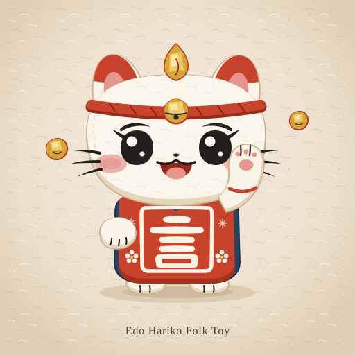
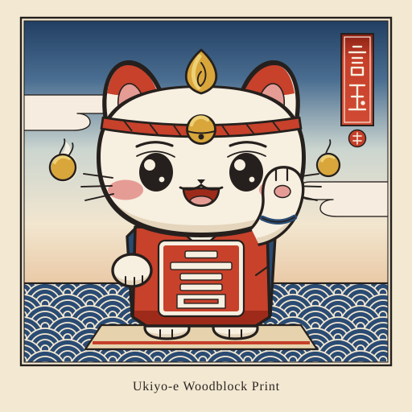
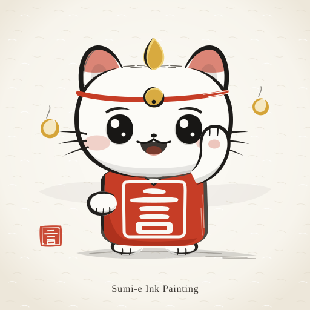

# Koto Style Study: Three Traditional Japanese Directions

| Edo Hariko Folk Toy | Ukiyo-e Woodblock Print | Sumi-e Ink Painting |
| :---: | :---: | :---: |
|  |  |  |

## A. Edo Hariko Folk Toy (`koto-a-hariko.svg`)

Defined by matte chalky *gofun* (oyster-shell white) over hand-moulded papier-mâché, slightly organic silhouettes, mineral vermilion (*shu*) and folk indigo (*ai*), faceted gold-leaf (*kinpaku*) accents over red bole, tiny painted *ume* and *asanoha* motifs, and tapered sumi brushstrokes on warm *kōzo* washi—trading plastic gloss for warm handmade craft. Across the game, **buttons** become soft matte washi tags and gentle lacquered wood plaques without heavy borders, **scenes** read like layered paper-craft dioramas with subtle mulberry-fibre grain, and **yokai** become charming folk-toy cousins (painted *hariko* foxes, lanterns, and *daruma*-like spirits) that stay friendly and legible down to 40 px.

## B. Ukiyo-e Woodblock Print (`koto-b-ukiyoe.svg`)

Defined by a disciplined *nishiki-e* carved-block palette, warm cherrywood-printed sumi contours of varying weight, flat colour planes with tiny hand-pulled registration (*kentō*) slivers, wiped *bokashi* sky gradations, geometric *seigaiha* waves and *suyarigasumi* cloud bands, and vertical vermilion *tanzaku* title slips. Across the game, **buttons** take the form of clean dyed-paper slips and quiet seal badges with generous breathing room, **scenes** gain iconic *bokashi* horizons and crisp woodblock architecture inspired by Hiroshige, and **yokai** step straight out of Kuniyoshi and Toriyama Sekien prints as playful chibi woodblock creatures with bold silhouettes.

## C. Sumi-e Ink Painting (`koto-c-sumie.svg`)

Defined by spontaneous calligraphic brushwork (*fude*) combining rich wet sumi, soft bleeding grey washes (*nijimi*), feathered dry-brush bristle streaks (*kasure*), and open unpainted white washi (*yohaku*), punctuated only by vermilion (robe, headband, and *hanko* stamp) and a touch of brushed gold (*kindei*) on the flame and word-orbs. Across the game, **buttons** become airy ink-washed paper pills accented with a vermilion seal mark on primary actions, **scenes** unfold as serene atmospheric ink-and-mist landscapes with quiet negative space, and **yokai** feel like living spirits painted straight out of a brushstroke scroll (*hyakki yagyō*) with expressive ink motion.

**Review note (Alyssa's AI):** in `koto-b-ukiyoe.svg` the title cartouche reads 言玉, not 言霊 (kotodama). Fix it before this style is used anywhere.
